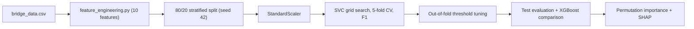
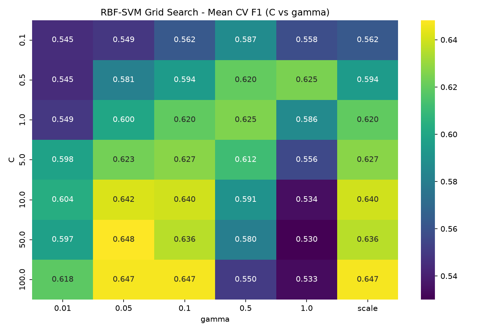
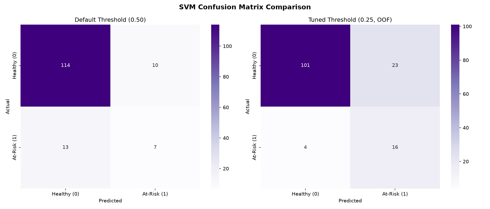
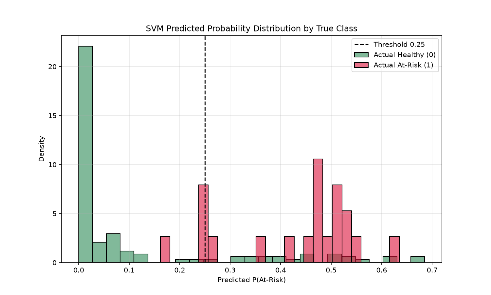
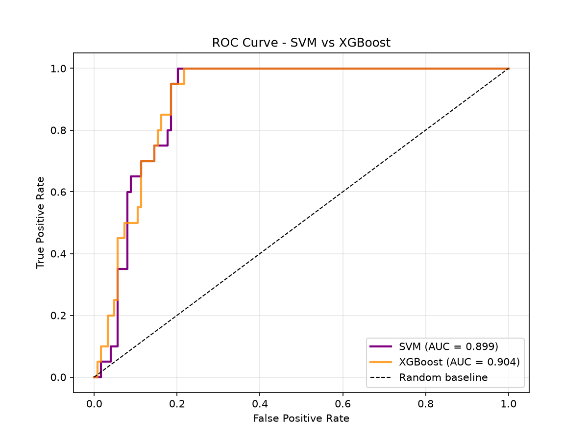
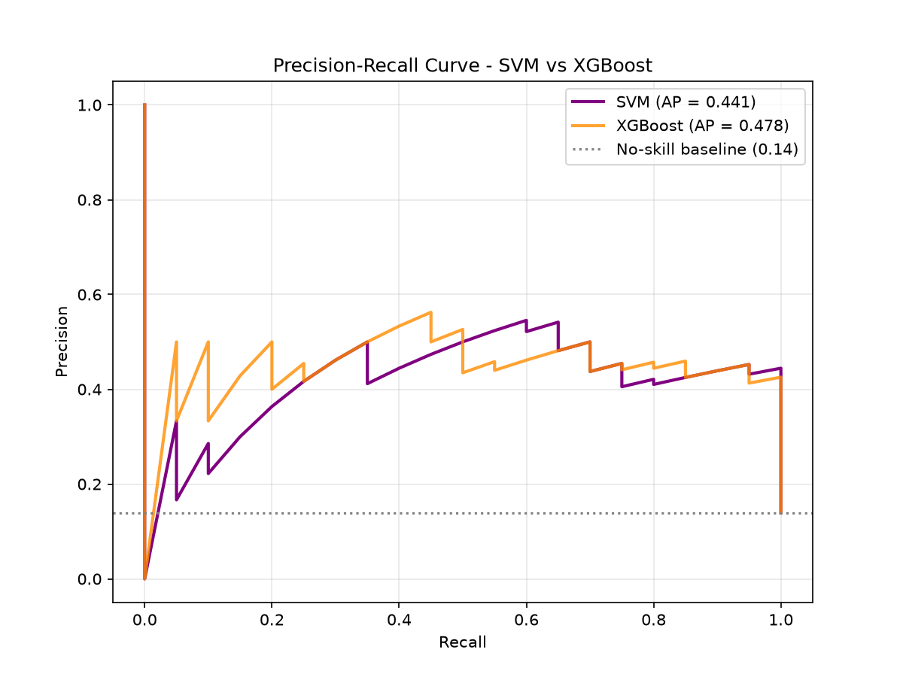
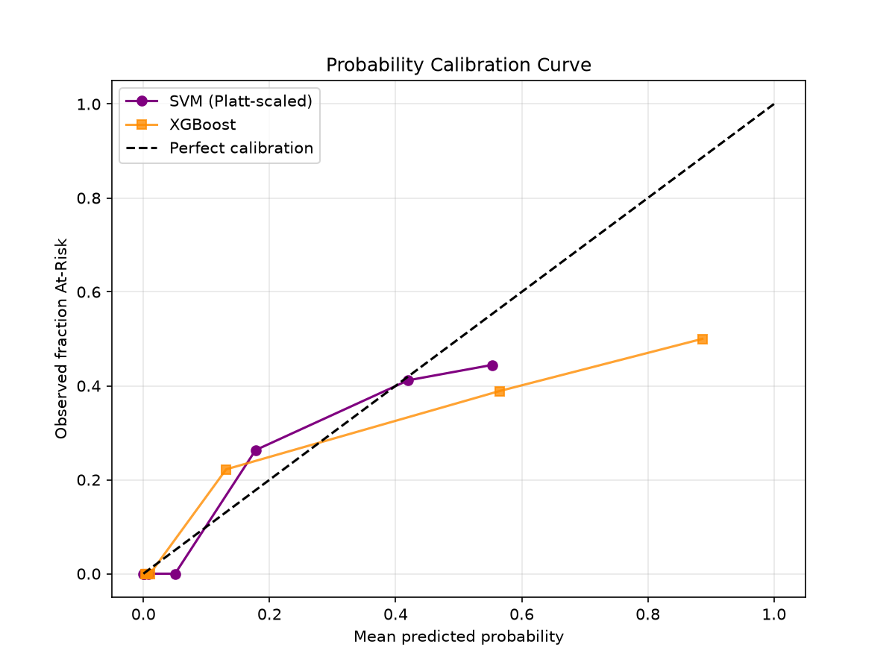
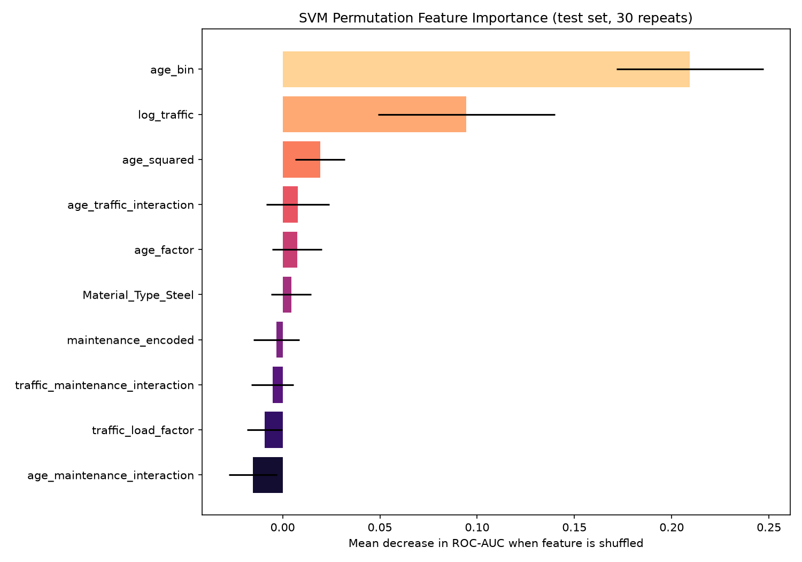
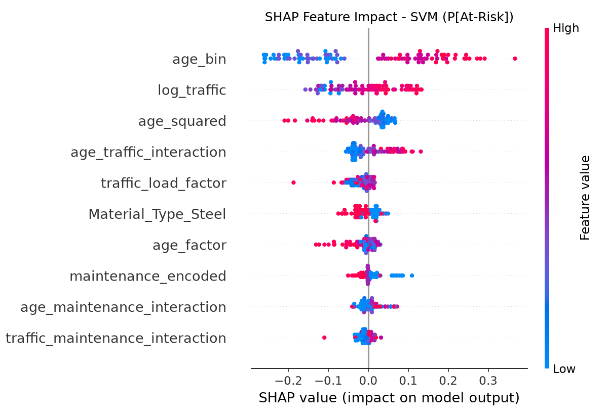
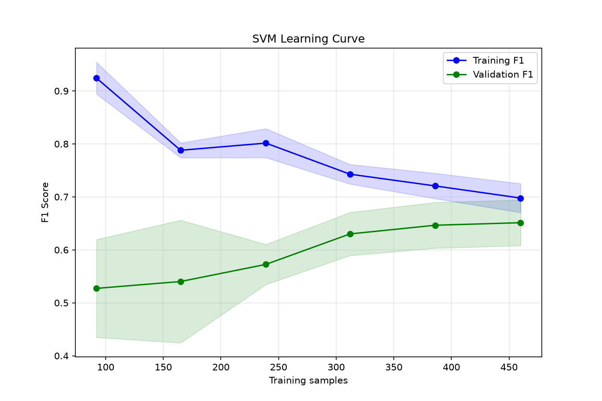

# SVM Model: Performance & Analysis Report

**Project:** BridgeTwinAI, AI Pipeline
**Task:** Binary classification of `Bridge_Condition` (0 = Healthy, 1 = At-Risk)
**Dataset:** `dataset/bridge_data.csv` (720 rows, public tabular dataset)
**Script:** [`ai_pipeline/src/train_svm.py`](../../src/train_svm.py)
**Raw metrics:** [`svm_performance_metrics.txt`](svm_performance_metrics.txt) · [`svm_metrics.json`](svm_metrics.json)

> **Data note:** `bridge_data.csv` is a generic public tabular dataset (age, traffic, material, maintenance). It is **not** inspection or sensor data for Vashi Bridge, Atal Setu or Bandra-Worli Sea Link. Every result below is a prototype estimate, not a certified engineering assessment.

---

## 1. Executive Summary

| Item | Result |
|---|---|
| Selected model | RBF-kernel SVC, `C = 50`, `gamma = 0.05`, `class_weight = 'balanced'` |
| CV F1 (5-fold) | **0.648 ± 0.047** |
| Test ROC-AUC | **0.899** (XGBoost: 0.904) |
| Test PR-AUC | **0.441** (XGBoost: 0.478; no-skill baseline: 0.139) |
| Test Brier score | **0.085** (XGBoost: 0.108; lower is better) |
| Best test operating point | Native SVM boundary: Recall **0.95**, Precision 0.44, F1 0.60, MCC 0.57 |
| Training time | ~15 s (52 grid configurations, plus SHAP) |

**Verdict:** The SVM is a strong second model. It ranks bridges by risk almost as well as XGBoost (ROC-AUC gap 0.005) and gives better-calibrated probabilities (lower Brier score). XGBoost is still ahead on PR-AUC, and its SHAP explanations are much faster to compute. I recommend keeping **XGBoost as the primary classifier** and using the **SVM as a second opinion or ensemble member**.

---

## 2. Methodology



| Measure | Why it matters for an SVM |
|---|---|
| **StandardScaler inside the pipeline** | SVMs work on distances. Without scaling, `age_traffic_interaction` (values in the hundreds of thousands) would swamp `maintenance_encoded` (0–2). Putting the scaler inside the pipeline keeps CV folds free of leakage. |
| **`class_weight='balanced'`** | At-Risk is only 14% of the data (6.13 : 1). Balanced weights raise the penalty for misclassifying At-Risk samples by about 6×. |
| **Grid search over 52 configs** | Kernels: RBF (7 C × 6 gamma), linear (4 C), polynomial (3 C × degree 2/3). |
| **Leak-free threshold tuning** | The probability threshold is tuned on **out-of-fold training predictions**, and the test set is never used. (The XGBoost script tuned its threshold on the test set, so its "tuned" numbers are optimistic. See §6.) |
| **Model-agnostic explainability** | SVMs have no native feature importance. I used permutation importance (30 repeats) and SHAP `KernelExplainer`. |

The SVM uses **the same features and the same split** as the XGBoost model, so the comparison is like-for-like.

---

## 3. Hyperparameter Search



| Kernel | Best CV F1 |
|---|---|
| **RBF** | **0.648** |
| Linear | 0.624 |
| Polynomial | 0.607 |

**Analysis**
- **The non-linear kernel wins, but only narrowly.** RBF beats linear by about 0.024 F1. The decision boundary is mildly non-linear. The engineered features (`age_squared`, the interaction terms, `age_bin`) already capture much of that non-linearity, which is why a linear SVM is competitive.
- **There is a clear stable region.** High `C` (10–100) with low-to-moderate `gamma` (0.05–0.1 or `'scale'`) consistently scores about 0.64. That plateau means the chosen settings are not a lucky spike.
- **Large `gamma` overfits.** At `gamma = 1.0`, F1 falls to about 0.53 as `C` grows. Each support vector's influence becomes very local, and the model memorises training points.
- **Support vectors:** 147 of 576 training points (25.5%). That includes 36 of about 81 At-Risk training samples (about 44%), so the minority class sits close to the boundary. This matches the class overlap seen in §5.

---

## 4. Cross-Validation Results (training set, 5-fold)

| Metric | Mean ± Std |
|---|---|
| F1 | 0.648 ± 0.047 |
| Recall | 0.938 ± 0.097 |
| Precision | 0.497 ± 0.034 |
| ROC-AUC | 0.923 ± 0.027 |
| Accuracy | 0.858 ± 0.018 |

The low standard deviations (≤ 0.05 for F1 and AUC) show the model is **stable across folds**. These CV numbers use the SVM's native decision rule (`decision_function > 0`). With balanced class weights, that rule favours recall.

---

## 5. Test-Set Performance

### 5.1 Three decision rules compared

| Metric | **Native f(x) > 0** | P ≥ 0.50 | P ≥ 0.25 (OOF-tuned) |
|---|---|---|---|
| Accuracy | 0.826 | 0.840 | 0.813 |
| Balanced accuracy | **0.878** | 0.635 | 0.807 |
| Precision (At-Risk) | **0.442** | 0.412 | 0.410 |
| Recall (At-Risk) | **0.950** | 0.350 | 0.800 |
| Specificity | 0.806 | **0.919** | 0.815 |
| F1 | **0.603** | 0.378 | 0.542 |
| MCC | **0.572** | 0.289 | 0.478 |
| TN / FP / FN / TP | 100 / 24 / **1** / 19 | 114 / 10 / 13 / 7 | 101 / 23 / 4 / 16 |

Threshold-independent metrics: ROC-AUC 0.899 · PR-AUC 0.441 · Brier 0.085.



### 5.2 Key finding: the native boundary and Platt probabilities disagree



An SVM does not produce probabilities directly. `probability=True` fits a separate logistic (Platt) model on internal cross-validation, and that model learns the **true base rate** (about 14% At-Risk). The plot shows the result: At-Risk bridges cluster at **P ≈ 0.45–0.55** and almost never go above 0.65. So:

- A **0.50 probability cut-off misses 13 of 20 at-risk bridges** (recall 0.35). For safety-critical infrastructure, that is unacceptable.
- The **native margin boundary** already includes the balanced class weighting. It catches 19 of 20 at-risk bridges.
- The OOF-tuned threshold (0.25) lands between the two. On this test set, the best threshold would have been 0.13, which I did *not* use because that would leak test information. The gap between 0.25 and 0.13 shows how unstable threshold estimates are with only 20 positive test cases.

> [!IMPORTANT]
> **Recommendation for deployment:** use the SVM's **native decision boundary** (`model.predict`) for the At-Risk flag. Use `predict_proba` only as a calibrated risk *score* for ranking. This choice can be justified from training data alone: in CV the native rule matched the OOF-tuned threshold on F1 (0.648 vs 0.658) with higher recall (0.94), and recall matters most for bridge safety. It does not depend on the test results. `models/svm/svm_threshold.json` currently stores the 0.25 Platt threshold. Change it if you adopt this recommendation.

### 5.3 ROC and Precision–Recall

| ROC | Precision–Recall |
|---|---|
|  |  |

- **ROC-AUC 0.899:** if you pick one at-risk and one healthy bridge at random, the SVM gives the at-risk bridge the higher score about 90% of the time.
- **PR-AUC 0.441:** this is 3.2× the no-skill baseline (0.139). PR-AUC is the stricter metric under class imbalance. The fairly low absolute value means **precision is the main weakness**: about 1 in 2.3 "At-Risk" flags is a false alarm (24 false positives in the native-boundary results).

### 5.4 Calibration



The SVM's Brier score (0.085) beats both XGBoost (0.108) and the no-skill reference (p(1−p) ≈ 0.120 on this test set). That is a **Brier skill score of about 0.29**. XGBoost's `scale_pos_weight` pushes its probabilities upwards, while Platt scaling keeps the SVM's probabilities closer to observed frequencies. **The SVM's probabilities are the more trustworthy of the two as literal risk percentages** for a dashboard.

---

## 6. SVM vs XGBoost (identical test split)

| Metric | SVM (native) | SVM @ 0.25 | XGB @ 0.22* | XGB @ 0.50 |
|---|---|---|---|---|
| ROC-AUC | 0.899 | 0.899 | **0.904** | **0.904** |
| PR-AUC | 0.441 | 0.441 | **0.478** | **0.478** |
| Brier ↓ | **0.085** | **0.085** | 0.108 | 0.108 |
| Recall | **0.950** | 0.800 | **0.950** | 0.700 |
| Precision | 0.442 | 0.410 | **0.452** | **0.467** |
| F1 | 0.603 | 0.542 | **0.613** | 0.560 |
| MCC | 0.572 | 0.478 | **0.582** | 0.486 |
| Balanced acc. | 0.878 | 0.807 | **0.882** | 0.786 |

\* XGBoost's 0.22 threshold was tuned **on this same test set** in `train_model.py`, so that column is optimistically biased.

**Interpretation**
- **Ranking ability is essentially tied** (ΔAUC = 0.005). With 20 positive test cases, that gap is well inside sampling noise.
- On the operating-point metrics, the SVM's native boundary differs from XGBoost's test-tuned threshold by **just one false positive** (24 vs 23). The SVM reaches that without seeing the test set at all.
- **Uncertainty:** with 20 positives, each at-risk bridge is worth 5 points of recall. The 95% Wilson interval for 19/20 recall is **[0.76, 0.99]**, and for 16/20 it is **[0.58, 0.92]**. Treat any recall difference of one or two bridges between the models as **not statistically significant**.
- **XGBoost's practical advantages:** fast exact TreeSHAP for per-prediction explanations in the API, slightly better PR-AUC, and no need for feature scaling.
- **SVM's practical advantages:** better-calibrated probabilities and a boundary that needs no threshold tuning. It also makes its errors in a different way (margin-based rather than tree-split), which makes it useful in an ensemble.

---

## 7. Explainability

| Permutation importance (ΔROC-AUC) | SHAP (mean \|impact\| on P[At-Risk]) |
|---|---|
|  |  |

| Rank | Feature | Permutation ΔAUC | SHAP mean \|value\| |
|---|---|---|---|
| 1 | `age_bin` | **+0.209** ± 0.038 | **0.154** |
| 2 | `log_traffic` | **+0.095** ± 0.046 | **0.066** |
| 3 | `age_squared` | +0.019 ± 0.013 | 0.049 |
| 4 | `age_traffic_interaction` | +0.008 ± 0.016 | 0.038 |
| 5 | `age_factor` | +0.007 ± 0.013 | 0.022 |
| – | Maintenance features, `Material_Type_Steel`, `traffic_load_factor` | ≈ 0 (within noise) | 0.012 – 0.023 |

**Analysis**
- **Age dominates, and in a step-wise way.** The binned age feature matters more than raw or squared age. That suggests the condition label changes sharply at age bands (bins at 25/50/75/100 years) rather than smoothly. This is consistent with how a dataset like this may have been generated or labelled.
- **Traffic is the clear second factor.** It works best on a log scale, which fits an engineering view of fatigue where load cycles matter on a logarithmic scale.
- **Maintenance shows almost no importance.** Engineering intuition says maintenance should matter, so this is counter-intuitive. Possible causes: (a) the dataset's label really is weakly tied to maintenance; (b) its effect is already absorbed by the age interactions; or (c) the dataset is too small to detect it. **I would not conclude from this model that maintenance does not matter for real bridges.**
- **The two explanation methods agree** on the top four features. Agreement between two independent methods makes the explanation more credible.
- Several features have importances that are effectively zero. A smaller feature set (`age_bin`, `log_traffic`, `age_squared`, `age_traffic_interaction`) would probably perform about the same and be simpler to explain.

---

## 8. Generalisation & Overfitting



| Metric (P ≥ 0.25) | Train | Test | Gap |
|---|---|---|---|
| ROC-AUC | 0.948 | 0.899 | +0.049 |
| F1 | 0.692 | 0.542 | +0.150 |
| Recall | 1.000 | 0.800 | +0.200 |

- The **ROC-AUC gap (0.05) is moderate**. The model generalises reasonably, given that `C = 50` is a fairly hard margin.
- The large recall gap is partly an artefact of the small test set: 4 missed bridges out of 20.
- **Learning curve:** training F1 falls and validation F1 rises steadily, and the gap at 460 samples narrows to about 0.05. Validation F1 has **not plateaued**, so **more labelled data would most likely improve the model**. That is the most effective next step, more so than further tuning.

---

## 9. Limitations

1. **Small minority class:** 101 At-Risk samples in total and 20 in the test set, so confidence intervals on every recall-based metric are wide.
2. **Dataset is not Mumbai-specific:** the model learns general patterns from a public dataset. It must not be presented as an assessment of the three demo bridges.
3. **The comparison favours XGBoost** because its threshold was tuned on the test set. A fair comparison would re-tune XGBoost on out-of-fold predictions too.
4. **SHAP for SVM is approximate:** KernelExplainer used a 25-centroid background and 300 samples on 100 test rows. It is fine for global analysis but too slow for real-time per-request explanations.
5. **Precision ≈ 0.44:** roughly one false alarm per true detection. That suits a "flag for inspection" workflow, not automated action.

---

## 10. Recommendations

1. **Keep XGBoost as the primary classifier.** Add the SVM as a **second-opinion model**. A bridge flagged by both models is a high-confidence alert.
2. **Use the SVM's native boundary** for its At-Risk flag, and its Platt probability as a calibrated risk score for dashboard ranking.
3. **Fix the XGBoost threshold leak** by re-tuning on out-of-fold predictions, so the comparison is fully fair.
4. **Try a soft-voting ensemble** (SVM + XGBoost probabilities). The models are about equally good but make errors differently, so averaging may improve PR-AUC.
5. **Collect or augment At-Risk samples.** The learning curve shows the model is still data-limited.

---

## 11. Saved Artefacts

| Path | Contents |
|---|---|
| `models/svm/svm_condition_model.joblib` | Full sklearn `Pipeline` (StandardScaler + SVC). Takes the 10 engineered features. |
| `models/svm/svm_features.json` | Ordered feature list expected by the pipeline |
| `models/svm/svm_threshold.json` | OOF-tuned Platt threshold (0.25) and how it was selected |
| `models/svm/svm_best_params.json` | Best hyperparameters and CV F1 |
| `notebooks/svm/svm_grid_search_results.csv` | All 52 grid configurations with CV scores |
| `notebooks/svm/svm_permutation_importance.csv` | Feature importances with standard deviations |
| `notebooks/svm/*.png` | 9 diagnostic plots (referenced above) |

**Loading example**
```python
import joblib, json, pandas as pd
from feature_engineering import perform_feature_engineering

model = joblib.load("ai_pipeline/models/svm/svm_condition_model.joblib")
features = json.load(open("ai_pipeline/models/svm/svm_features.json"))

X, _ = perform_feature_engineering(df)
X = X[features].astype(float)
flag = model.predict(X)                 # native boundary (recommended)
risk = model.predict_proba(X)[:, 1]     # calibrated risk score
```

**Reproduce:** `cd ai_pipeline/src && python train_svm.py`
